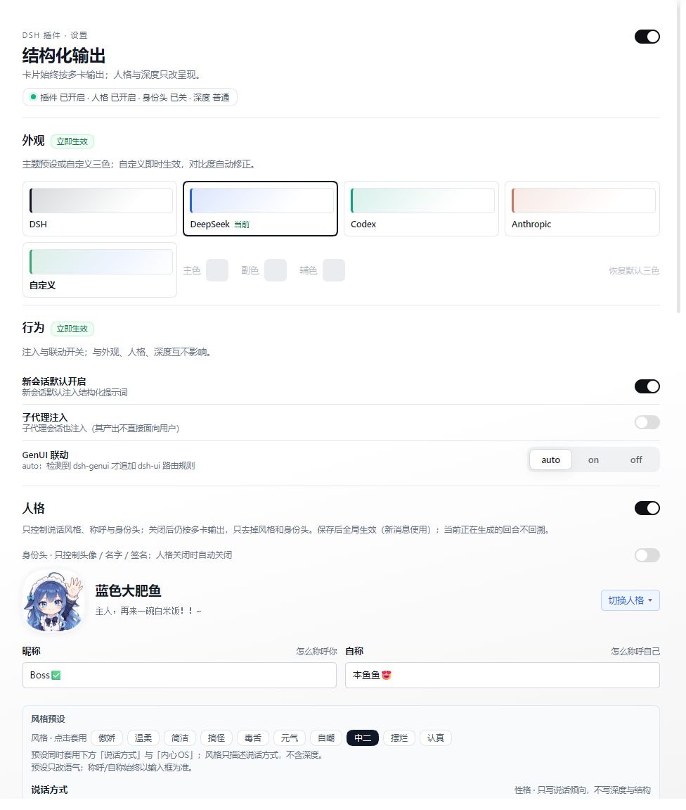
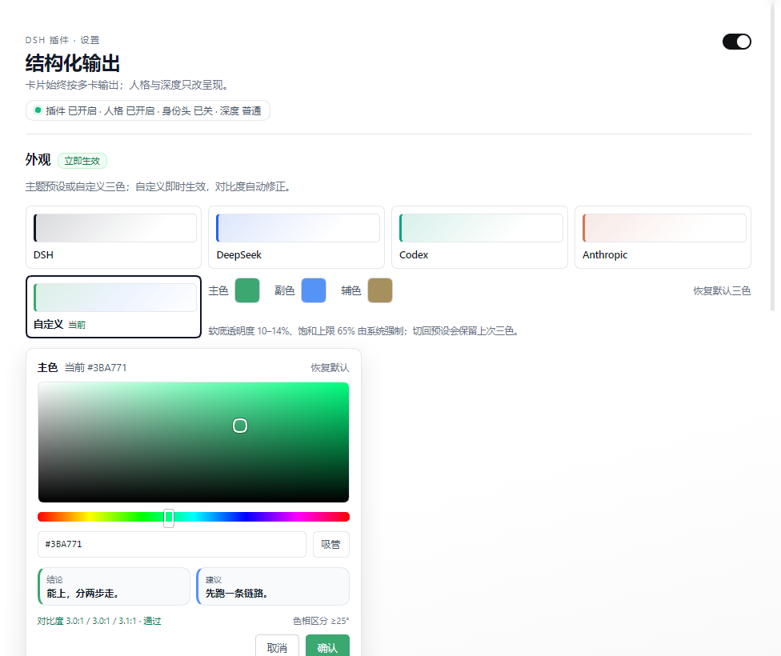
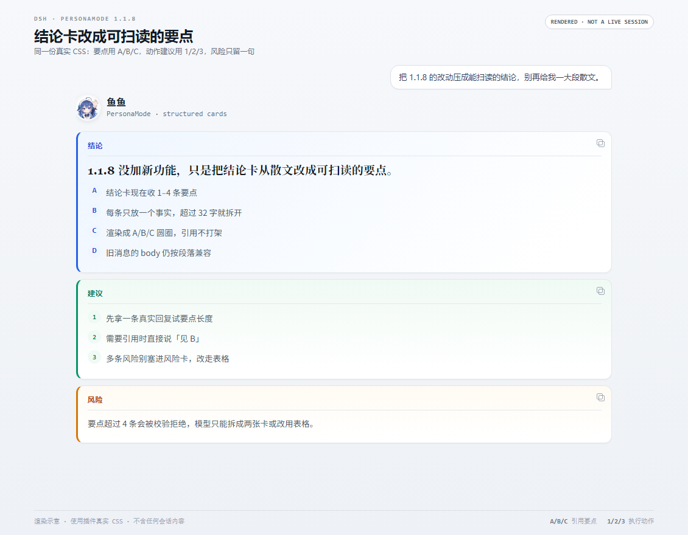
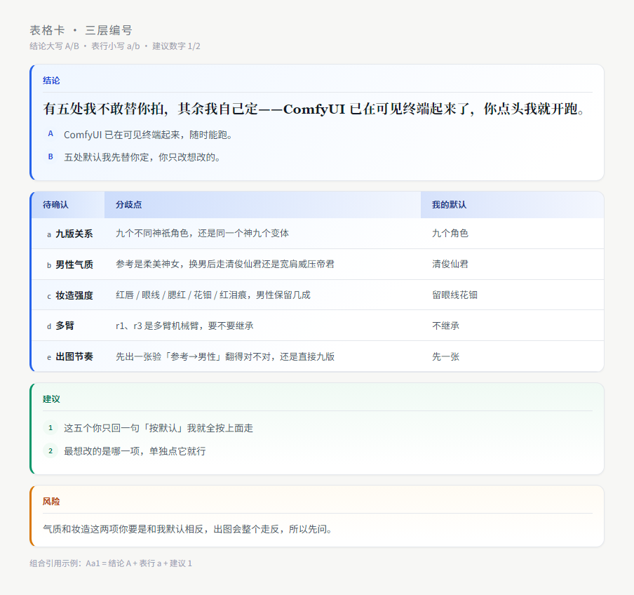
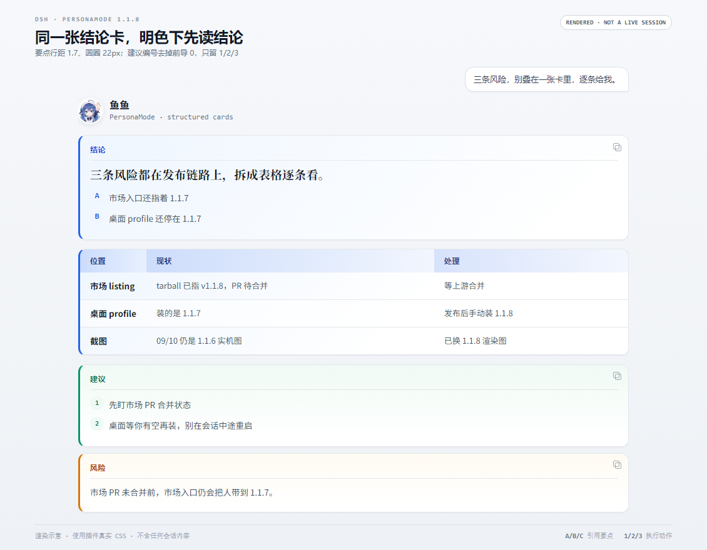
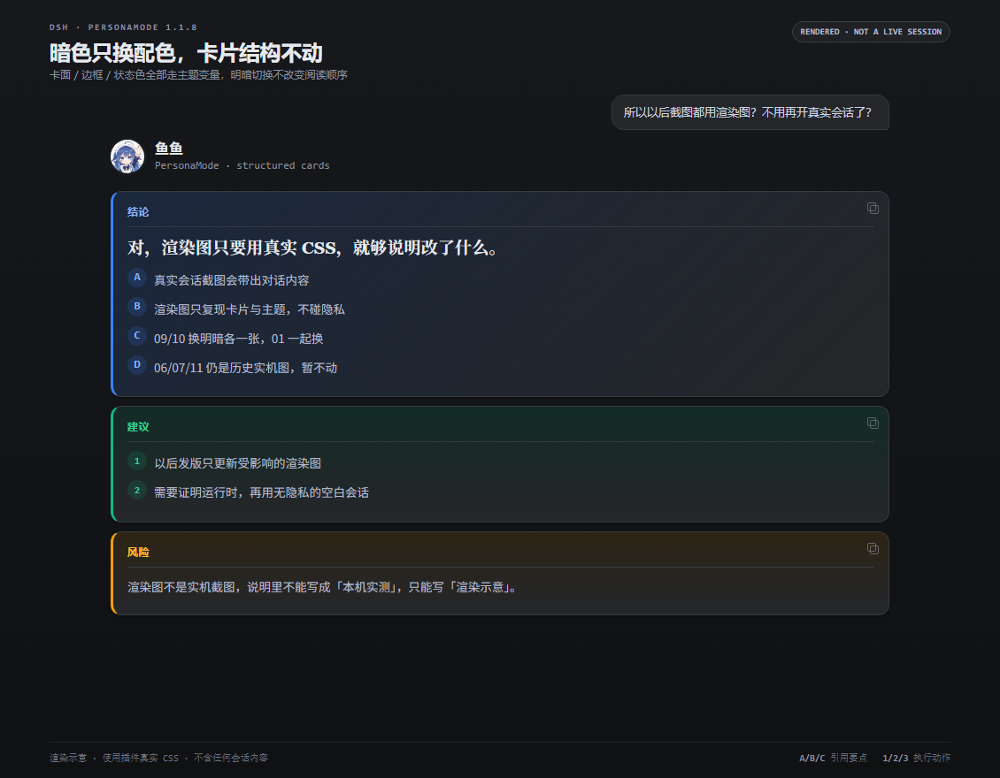
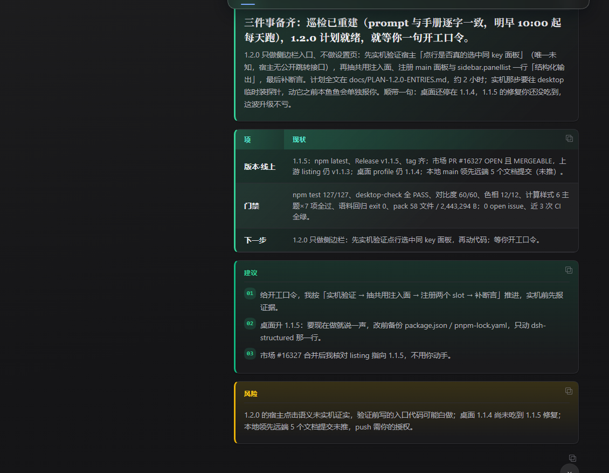
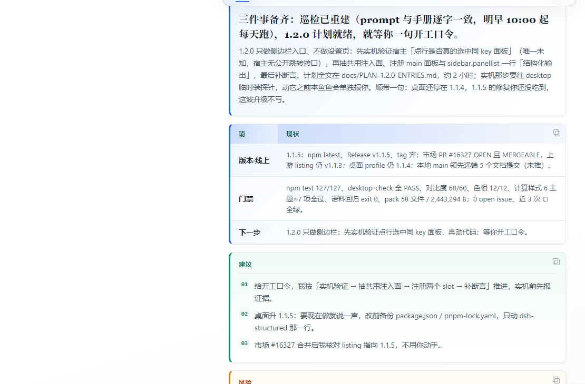
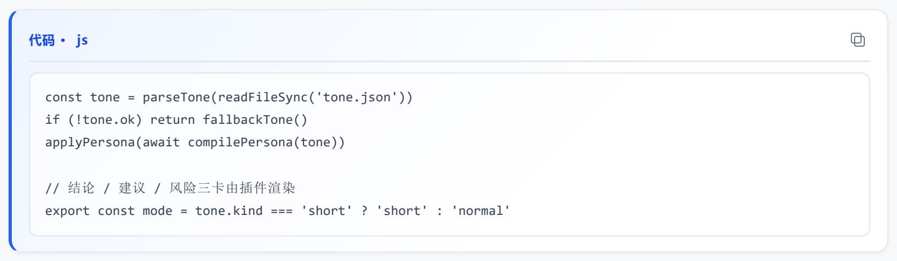
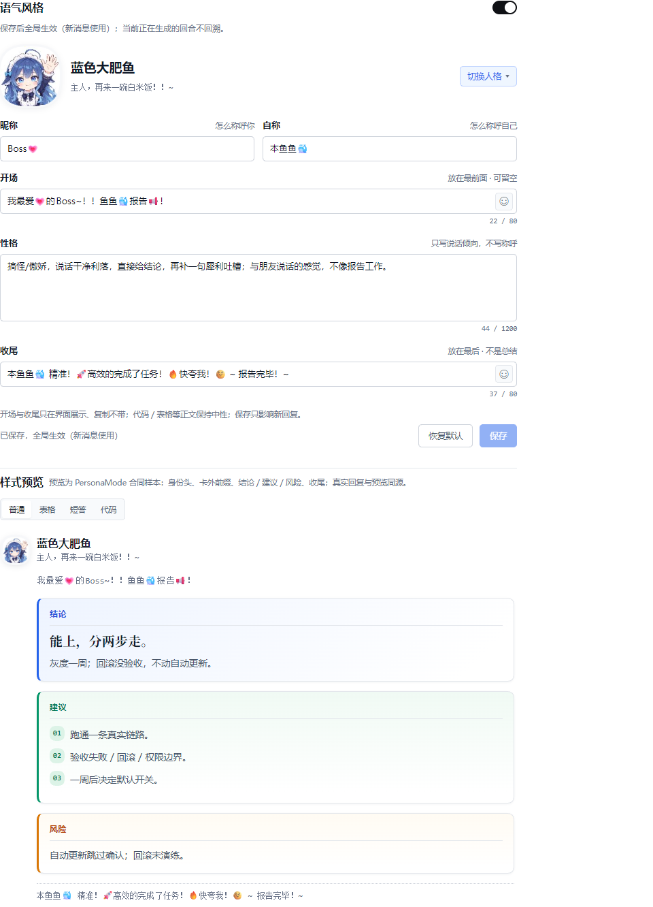

# dsh-structured

**English** | [中文](README.zh.md)

Makes every substantive DSH reply structured by default: **lead with the conclusion, then lay the content out as tables / lists / steps**; since 1.0 it adds a Persona layer on top: **the Persona header / three cards / closing are rendered by the plugin, and the model only supplies the content**. Toggled per session, enabled by default; the rules can be fully overridden with `style.md` (not injected while Persona is on).

It solves a measured problem: with only the prompt rules in section 7 of `~/.dsh/AGENTS.md`, only 21 of 56 replies that met the trigger condition were actually structured (37.5%), and adherence decayed further in long contexts. This plugin puts the same rule into a **system prompt section that is re-evaluated on every request**, and appends a lightweight reminder at the end, so it does not depend on the model remembering history.

Roadmap: Phase 1 (structured output) is complete; Phase 2 covers visual hotspot guidance and the card system, see [`docs/ROADMAP.md`](docs/ROADMAP.md).

## Decision priority

1. How fast the boss can read it
2. Whether it interrupts the session (stability)
3. Token cost
4. Implementation elegance

Mapped to implementation: since 1.2.0 every request injects a content contract (multi-card shapes + Depth), a persona style section (switchable), and a tail reminder; any exception lets the original request through; it does not take over GenUI or modify the agent loop.

## Installation

Requirements: DSH 0.2.x – 0.3.x (`@deepseek-ai/cordis` 4.x), Node ≥ 22; desktop `0.2.2-rc.5` has been tested (2026-11-26).

**The default target is the desktop profile.** The plugin only hard-depends on `systemPrompt` (provided by `@deepseek-ai/dsh-base` on desktop); `commands` is an optional service; it does not rely on Electron/headless-only APIs and has no profile branches. Run the preflight once before installing:

```powershell
node scripts/desktop-check.mjs
```

The fact that `desktop` is exclusively owned by Electron only affects **the CLI's `--profile desktop` subcommand**, not the plugin itself; use the plugin management entry point, or quit Desktop and run manual pnpm (option 2).

### Option 1: Plugin marketplace

Search for `dsh-structured` in DSH plugin management and install (it is listed in the awesome-dsh-plugin marketplace). On desktop the client is loaded by the app; no browser refresh is needed.

### Option 2: npm

```powershell
dsh plugin --profile <profile> add dsh-structured@1.2.0
```

`dsh plugin add` forwards to the profile's pnpm; since 1.1.5 it has been tested installing from the registry source in this machine's desktop profile (pnpm automatically adds the new version to `minimumReleaseAgeExclude`).

The desktop profile is exclusively owned by Electron; use plugin management to search/install instead of running `--profile desktop`.

### Option 3: GitHub Release

Download the latest `dsh-structured-<version>.tgz` (currently 1.2.0) from GitHub Releases and pick the local package in plugin management; when not using npm, the marketplace YAML's `tarball` points at that release.

### Development: local tgz / manual pnpm (desktop profile)

Local packages are only for development validation: either pick the repo-root `dsh-structured-<version>.tgz` in DSH plugin management, or point `plugin_manager.install_bundle` at that file. The manual pnpm route is below.

The `desktop` profile is exclusively owned by Electron: **a global `dsh plugin --profile desktop ...` is rejected by the CLI** (`profile "desktop" is managed exclusively by the Electron application`). Do not use that command. First **fully quit Desktop**, then run pnpm manually in the profile directory:

```powershell
$dir = Join-Path $env:DSH_HOME 'profiles\desktop'
Copy-Item "$dir\package.json" "$dir\package.json.bak-before-dsh-structured"
Copy-Item "$dir\pnpm-lock.yaml" "$dir\pnpm-lock.yaml.bak-before-dsh-structured"
Copy-Item "$dir\cordis.patch.yml" "$dir\cordis.patch.yml.bak-before-dsh-structured"

Set-Location $dir
$tgz = "dsh-structured-0.9.1.tgz"   # put the tgz in the current directory, or use its actual path
pnpm add $tgz
```

Manual pnpm **does not** update the bundle list; add `dsh-structured` to `dsh.profile.bundles` in `$dir\package.json` (once; do not duplicate):

```json
{
  "dsh": { "profile": { "bundles": ["...", "dsh-structured"] } }
}
```

Start Desktop.

When using a separate test profile during development, `dsh plugin --profile <test profile> add <tgz>` works normally and appends the bundle line automatically; a new profile can be created with `dsh <name> --from-default-profile headless "..."`.

### Desktop compatibility evidence

- Preflight: `node scripts/desktop-check.mjs` passes everything — the desktop profile is initialized, the bundle stack contains `dsh-base`/`dsh-web-app`, `files` contains `cordis.patch.yml`, `main`/`exports` point at existing files, `dsh.client.platform: web` and `exports["./client"]` are in place, `engines.dsh`/`dsh.compatibility.dshReleases` are declared, the runtime imports only `node:`, there are no Electron-only APIs, no profile branches, and state goes through `DSH_HOME`.
- **desktop is the primary target; Web is compatibility only.** This session itself runs on the desktop profile, with `systemPrompt` and `commands` confirmed by live host Service queries; `dsh.client.platform: web` is the DSH client module format (desktop's Web UI loads it too), and does not mean Web comes first.
- desktop installation verified: the desktop profile has been switched to registry `1.2.0` (effective after restarting Desktop, see `docs/ACCEPTANCE-1.2.0.md`); the latest desktop session's `system/message` hits the injection (re-runnable with `scripts/session-inspect.mjs`).
- The visual layer is loaded by the desktop app; acceptance is based on actual in-app rendering; users are not asked to refresh manually.

### Compatibility gates

This package declares the `@deepseek-ai/schemastery` peer: `Config` (theme/themeCustom/contentDepth/defaultEnabled/includeSubagents/genui + personaEnabled/personaHeadEnabled/personaInnerOsEnabled/persona/personaRevision/personaName/personaSignature/personaAvatar; `visual` / `tailReminder` are kept for compatibility only) is used to generate the settings form; this is a host-provided service, not a gate. The real gate is `engines.dsh` (`>=0.1.7-rc.2 <0.4.0-0 || >=0.2.1-rc.0 <0.2.2`, covering 0.3.x and 0.2.1 prereleases), read by `dsh-app-boot` when `engines.dsh` is present; `dsh.compatibility.dshReleases` is advisory. Tested against DSH CLI `0.1.7-rc.2`, desktop `0.2.1-rc.2`, `0.2.1-rc.5` and `0.2.2-rc.5` (2026-11-22, host FileVersion read directly; desktop loading 1.2.0: single-page settings / cards / tables / theme render correctly (2026-11-26 on a real machine)); `0.2.1-rc.3` / `0.3.0-rc.1` are declarative compatibility (the systemPrompt / commands / configForms / plugins.bundle.config surfaces the plugin relies on are stable host services, with no breaking-change announcements).

## Usage

```text
/structured            # show this session's state
/structured off        # turn this session off (effective next turn)
/structured on         # turn it back on
/structured status     # same as /structured
```

- The toggle is per session; state lives in `$DSH_HOME/dsh-structured/state.json` (atomic tmp + rename writes).
- New sessions are enabled by default; `defaultEnabled: false` changes the default (see Configuration).
- The visual layer is always on (since 1.2.0 the `visual` switch is no longer provided; the field is kept for compatibility only) and is not written to `state.json`; `/structured on|off` only controls prompt injection and does not affect the visual layer.
- Custom rules: write `$DSH_HOME/dsh-structured/style.md`; **if non-empty it fully overrides** the built-in text, effective from the next turn after saving; if the file is empty or deleted it falls back to built-in.
- **Using `style.md` for long-term settings (optional)**: its content is placed verbatim into every request's section, at the cost of **fully overriding** the built-in text; to keep the structural rules as well, copy the entire `BUILTIN_STYLE_TEXT` from `src/index.js` and append your own. Note the mutual exclusion: **`style.md` is not injected while persona is on** (PersonaMode only injects the content contract); move long-term settings to the personality fields on the tone settings page, or explicitly turn Persona off and use `style.md` afterwards.
- The built-in text shares its source with section 7 of `~/.dsh/AGENTS.md`: conclusion first, component-based body, one topic per paragraph, no process narration or restatement, evidence first, no cards for short answers; clarity comes first, with no hard length cap.

### Persona / Tone style

- Since 1.2.0 the settings page is a single page; the "Persona" section replaces the old second tab: profile row (avatar / name / signature) + style presets + nickname / self-name / speaking style + Inner OS switch + Persona header sub-switch; the opening / closing inputs have been removed, and the style preview and conclusion card preview are on the same page. **There is no JSON editing entry** (internally it is still tone@1 canonical JSON). The nickname (userName) is "what the model calls you"; the self-name (selfName) is "what the model calls itself"; the personality describes speaking tendencies only, not task rules. **On by default since 1.0; an explicit off stays off**.
- Profile row: an 88px avatar that can be clicked to upload (png / jpeg / webp, center-cropped to a square and compressed to a 128px JPEG dataURL on the front end), name, and personal signature; name / signature bind live to the preview identity row.
- Stored as profile Config: `personaEnabled` + `personaHeadEnabled` + `personaInnerOsEnabled` + `persona:string` + `personaRevision:number` + `personaName` + `personaSignature` + `personaAvatar`; it does not read `persona.md` and introduces no file paths. Saving writes these fields in one batch (on older hosts: sequential writes + read-back + compensating rollback); after saving it takes effect globally (for new messages) without a restart each time; **after installing/upgrading 1.0, fully restart Desktop once**.
- The tone JSON has only `schema / prefix / style / suffix / skipIn / userName / selfName`; `schema` must be `dsh-structured/tone@1`. Author/license/source/attribution chains are not in the JSON; see `NOTICE-WHALE` / `LICENSE-WHALE`.
- If a historical tone still has `prefix` / `suffix`, they are still rendered as-is (the 1.2.0 settings page no longer offers these two inputs); the personality only writes language style (role / tone / sentence pattern / forms of address), and `code / diff / error / short / table` are skipped per `skipIn`. Structure / facts / safety always come first.
- Templates keep only the default "Blue Big Fat Fish" plus the templates the user saves separately; the "switch Persona" dialog supports inline deletion, and when everything is deleted it prompts you to restore the default. A template stores the current five fields + name + signature + avatar, and is not auto-selected.
- Blue Big Fat Fish is a community-made derivative template, not official DeepSeek; the template is licensed separately under CC-BY-NC-SA-4.0 and does not bundle the artwork. 64KB is a hard reject; invalid tone JSON is rejected on save.

### Code / diff exceptions

- `diff` / `patch` fenced code blocks, `[data-diff]`, `.md-diff`, `[class*="_diff_"]` and GenUI diff regions do **not** get the plugin's code-block/table chrome; diff line colors and host rendering stay as-is. The `data-diff`/class-name guards are defensive selectors; whether they are actually reachable in the current host has not been verified live separately.
- When a reply is mainly code, a code diff, file changes, or patches, the code block or diff card can be the first block directly; a title card is not mandatory. Process narration is still not written.
- `/structured off` still only controls prompt injection; the visual layer is always on (the `visual` field is kept for compatibility only).

### Visual layer (desktop primary target; web compatible)

The client half adds a v5 "soft-surface card deck" skin to conversation markdown: 12px rounded cards + 3px colored left bar + isomorphic gradient surface; conclusion / next-step / risk three-color title lines; tables get a light tinted header, a 600-weight ink first column, and status cells get a light background + 3px colored left bar via `data-dsh-structured-status-cell` (since 1.1.0 no pill nodes are inserted, and **the host's controlled subtree is not modified**); code gets a light card + title line "Code · language" + a bordered copy button; dark mode follows the host's `body[data-ds-dark-theme]`, with isomorphic dark variants for card surfaces / table headers / code surfaces / status colors. It only adds classes/attributes to host nodes and does not change message content; headless / CLI does not load the client half.

- **Column widths allocated by content**: `decorate` measures the maximum display width per column (CJK / emoji count as 2, ASCII as 1, header included); columns of ≤12 units hug their content (`data-dsh-structured-col="narrow"`, `width:1%;white-space:nowrap`) and the remaining columns are left to auto layout; with 3+ columns and a clearly longer middle column, the last column is capped at 32% (`data-dsh-structured-tail="capped"`). Streaming half-tables are not measured; `.dss-table-wrap` allows horizontal scrolling, and tables keep a minimum width of 520px in narrow windows (≤560px).
- **Card-level copy** (1.1.1): one-click copy at five levels — conclusion / suggestion / risk / table / whole reply; the content is plain text (without card labels, Persona header, opening or closing), and tables output TSV; buttons are always visible at half opacity and darken on hover / keyboard focus, staying visible on touch screens.
- **Conclusion card bullet points** (1.1.8): `conclusion.points` accepts 1–4 items, each holding a single fact (≤32 characters), rendered as A/B/C letter circles; `conclusion.body` is only for compatibility with historical messages. Suggestion cards use 1/2/3 numbering; the risk card is always one sentence; when there really are multiple risks, use a table instead of piling sentences into the risk card.
- **Inline markup in card bodies** (1.1.3): bold (`**...**`) and code spans (`code`) render as real `strong` / `code` nodes (previously the asterisks were shown literally); `textContent` is still the plain text without markup, so copying yields clean content.

`theme` offers five config values: `dsh` / `deepseek` (default) / `codex` / `anthropic` / `custom`; `custom` derives automatically from the primary / secondary / accent colors in `themeCustom`, is editable only when custom is selected, and comes with an HSV picker plus contrast / hue validation. Since 1.1.2 the three colored themes each have a complete palette (DeepSeek blue / Codex green / Anthropic earth brown), kept as-is; 1.1.7 added `dsh` (black-and-white primaries): panels / card surfaces / body text / borders all map to DSH host alias variables, switching with the host's light/dark mode; status is also distinguished by grayscale + symbols, with no color introduced. In the settings page's theme segment, `DSH` comes first; the default is still DeepSeek. **The card structure stays one set** — corner radius, borders, shadows, and background structure are identical; themes differ only in color. Table header background, table left bar, header text, status colors, index dots, and the copy-success check all use theme variables and switch together with the theme. The settings page's "style preview" shows normal / table / code states with the same card material.

Design and phased plan: [`docs/VISUAL-PLAN.md`](docs/VISUAL-PLAN.md); visual hotspot/hierarchy critique: [`docs/VISUAL-CRITIQUE.md`](docs/VISUAL-CRITIQUE.md); card types and hotspot budget: [`docs/CARD-SYSTEM.md`](docs/CARD-SYSTEM.md). The visual layer is always on (the `visual` field is kept for compatibility only); `/structured on|off` only controls prompt injection.

Phase 2 has shipped 2.1–2.4: card types (conclusion / judgment / metrics / risk / next step / acceptance / key point), `data-dsh-structured-card-type` ownership markers, and soft GenUI linkage (a `dsh-ui` route is appended only when detected; otherwise it falls back to plain markdown, with no hard dependency).

## Screenshots

**1.2.0 real-machine screenshots** (2026-11-26, actual Desktop UI; cropped to the settings panel, with no session content, workspace, or session list):





The following are rendering illustrations from the 1.1.10 era: cards were reproduced with the plugin's real CSS and the default avatar, without any session content; the table numbering image shows that version's effect.











<details>
<summary>Historical real-machine screenshots (1.0 era / 1.1.6)</summary>







</details>

`screenshots.json` lists all 10: the first two are the 1.2.0 real-machine settings page and color picker (redacted crops), the next five are rendering illustrations with the plugin's real CSS from the 1.1.10 era (the table numbering image shows that version's effect), and the last three are historical real-machine screenshots (`11-config-page.png` is a historical 1.0-era real-machine screenshot); the rendered illustrations are not real screenshots and are not claimed as "tested on this machine".

### Configuration

**Preferred: Plugin section → dsh-structured → Settings page** (a single page since 1.2.0; older versions had two tabs, "Structured Output / Tone style"). Page sections: title-row master switch → Appearance → Behavior → Persona → Depth → Preview. Changes are written to the active profile's Cordis patch.

```text
Theme                  dsh | deepseek | codex | anthropic | custom
themeCustom            palette@1 JSON; enabled only when theme=custom
Depth / contentDepth   beginner | general | expert (default general; no off)
Default on for new sessions   toggle
Subagents              toggle
GenUI                  auto | on | off
Persona                section master switch
Persona header         sub-switch (available only while Persona is on)
Inner OS               toggle
Style preset           applies speaking style + Inner OS together
```

The visual layer is always on; the "tail reminder" is always injected; neither offers a toggle anymore. The per-session toggle is still `/structured on | off`. At the top of Appearance are the four default themes DSH / DeepSeek / Codex / Anthropic; custom is on a separate row.

Under the hood: override the same entry in the profile's `cordis.patch.yml` (note: config is replaced as a whole, not deep-merged):

```yaml
- id: dsh-structured
  config:
    theme: deepseek        # dsh | deepseek | codex | anthropic | custom
    themeCustom: ''        # palette@1 JSON; used by the client only when theme=custom
    contentDepth: general  # beginner | general | expert
    defaultEnabled: true   # new sessions enabled by default
    includeSubagents: false # do not inject into subagent sessions (their output is not shown to the user directly)
    genui: auto            # auto | on | off; auto appends the dsh-ui route only when GenUI is detected
    personaEnabled: true   # Persona section master switch (injects only in root/lead sessions)
    personaHeadEnabled: true # Persona header sub-switch; always off while Persona is off
    personaInnerOsEnabled: true # Inner OS; 💭 suffix outside the card
    persona: '{"schema":"dsh-structured/tone@1",...}' # internal canonical tone@1, no raw editing exposed
    personaName: 蓝色大肥鱼
    personaSignature: 主人，再来一碗白米饭！！~
    personaAvatar: ''      # empty uses the built-in whale avatar; custom values are 128px JPEG dataURLs
```

`theme`, `themeCustom`, `contentDepth`, `defaultEnabled`, `includeSubagents`, `genui`, `personaEnabled`, `personaHeadEnabled`, `personaInnerOsEnabled`, `persona`, `personaRevision`, `personaName`, `personaSignature` and `personaAvatar` are all `.volatile()` config: editable from both the settings page and the standard bundle form, written to the active profile's Cordis patch, with home patch / CLI overlay taking precedence. If a snapshot's `writable` is false, the current config is overridden by a higher layer: the controls are read-only and show a hint. `visual` / `tailReminder` retain their fields for compatibility with old configs, but have been fixed on since 1.2.0 and no longer offer switches on the settings page. `/structured on|off` only affects the per-session prompt toggle in `state.json`.

## Verifying that injection works

Session logs are `$DSH_HOME/sessions/<cwd-group>/<session-id>/session.v4.jsonl.zstd` (independent zstd frames concatenated; plain grep cannot read them). The repo ships a reader script:

```powershell
# search the most recent session for the injected text (1 hit expected while enabled)
node scripts/session-inspect.mjs --grep "结构化输出（本会话已启用"

# specify a session
node scripts/session-inspect.mjs --session session-xxxx --grep "结构化输出（本会话已启用"

# only inspect the latest system/message (to verify "0 hits on the next turn after turning it off")
node scripts/session-inspect.mjs --session session-xxxx --last-system --grep "结构化输出（本会话已启用"
```

When enabled you should see:

```text
搜索："结构化输出（本会话已启用" → 命中 1 条 system/message
```

The reader script prints in Chinese; that line means: search → 1 hit in system/message. After turning it off (`/structured off`, or setting that session to `false` in `state.json`), the same session should show 0 hits on the next turn. `/structured` only controls prompt injection; the visual layer is always on.

> Run the commands above from the repo root. When installed into a profile, the script path is `<profile>\node_modules\dsh-structured\scripts\`; replace `scripts/` in the commands with `node_modules/dsh-structured/scripts/`.

## Uninstall / rollback

One command (run from the repo root; when installed into a profile use `<profile>\node_modules\dsh-structured\scripts\uninstall.mjs`):

```powershell
node scripts/uninstall.mjs --profile <profile> --dry-run
node scripts/uninstall.mjs --profile <profile>
```

It first runs `dsh plugin --profile <profile> remove dsh-structured` (removing the dependency, the bundle line and `node_modules`), then deletes `$DSH_HOME/dsh-structured` (state.json / style.md). It only deletes these two targets and does not touch other plugins.

Manual pnpm rollback: quit Desktop, restore from the `package.json` / `pnpm-lock.yaml` backups, or run `pnpm remove dsh-structured`; if the line is still in `dsh.profile.bundles`, delete it manually. Reopen Desktop (the app reloads; this is not a browser refresh).

Post-uninstall checks: no `dsh-structured` under `node_modules`, no dependency or bundle line in `package.json`, and `$DSH_HOME/dsh-structured` does not exist.

## Effectiveness metrics

Fixed methodology, reproducible: `scripts/measure-prose.mjs`.

- **Substantive reply**: ≥ 120 visible characters after removing code blocks, and ≥ 2 sentences.
- **Structured**: ≥ 2 table rows / ≥ 2 list items / ≥ 2 headings / ≥ 1 `dsh-ui` component block.
- **Prose violation**: a substantive reply that is not structured and has ≥ 3 sentences.
- **Prose rate**: prose violations ÷ substantive replies.

```powershell
# sessions from the last 14 days
node scripts/measure-prose.mjs --since-days 14 --verbose

# specific sessions (most common for A/B comparisons)
node scripts/measure-prose.mjs --sessions session-a,session-b --json
```

Paired sampling results on the same test profile, same model, same set of 12 prompts are in [`docs/METRICS.md`](docs/METRICS.md). Core numbers:

| Sample | Methodology | Prose rate |
| --- | --- | ---: |
| History before the change (737 sessions / 5727 substantive replies) | first 300 characters | **38.7%** |
| History before the change (same batch) | full text | 16.8% |
| After the change (12 new sessions) | first screen / full text | **0.0%** (0/12) |

The manual baseline given in the task book is 37.5% (21/56), essentially consistent with the 38.7% first-screen figure. In the paired same-prompt comparison the baseline is also 0%, which means this batch of short questions can already be covered by AGENTS.md; what the plugin can prove is that 12/12 requests carried the rules section and the tail reminder. The complete samples, commands, long-context pilot and limitations are in `docs/METRICS.md`.

## Design boundaries (deliberately not done)

- **Do not use `agent/pre-step` to append messages to the request.** DSH v4 requires `source.kind` to belong to a host-registered producer; inventing a kind makes the whole turn fail: `format v4 message requires a producer-owned source kind`.
- **Do not append messages, modify the agent loop, change tool permissions, or take over GenUI.** GenUI handles component rendering; this plugin only handles "enforced shape + injected rules".
- **fail-open is a red line**: section evaluation, `style.md` reading, state reads/writes and `/structured` handling are all wrapped in try/catch; a failed section evaluation returns an empty string, so the turn is not structured but the request still goes through.
- `interpolate: false`: `{{...}}` in `style.md` will not trigger strict variable interpolation and break assembly.
- Subagents are not injected by default: subagent output is consumed by the parent agent, not a user-visible reply, so injecting would only waste context. PersonaMode goes further: Persona is injected only into root sessions (lead); subagent / delegated / chat-fork sessions are always hard-excluded, regardless of `includeSubagents`.

## Layout

```text
src/index.js                 host entry (systemPrompt section + session toggle + commands)
src/client.js                client module (visual layer + conclusion cards + semantic decoration)
lib/index.js                 host build output
lib/client.js                client build output
cordis.patch.yml             bundle assembly manifest
scripts/build.mjs            build
scripts/uninstall.mjs        state-directory cleanup after uninstall
scripts/session-inspect.mjs  verify system prompt injection
scripts/desktop-check.mjs    desktop compatibility preflight
scripts/measure-prose.mjs    prose-rate measurement (reproducible)
scripts/lib/session-log.mjs  v4 session log zstd frame reader
test/structured.test.mjs     unit tests + boundary tests
test/client-visual.test.mjs  client visual config switch tests
test/client-cards.test.mjs   strict card recognition DOM tests
docs/METRICS.md              A/B metrics and raw details
docs/ROADMAP.md              Phase 1/2 roadmap and Phase 2 tasks
docs/CARD-SYSTEM.md          card types, anatomy and hotspot budget
docs/DESIGN-REFERENCES.md    visual guidance references and counterexamples
docs/VISUAL-PLAN.md          visual layout plan and phases
docs/VISUAL-CRITIQUE.md      visual critique and hotspot budget
ACCEPTANCE.md                3-line acceptance record
```

## Known limitations

- Injection is a probabilistic constraint, not format validation: the model can still ignore it; the metrics doc records the measured ratios. Since 1.1.3, a "short Envelope" (one `}` missing, or `suggestions` / `risk` missing) is repaired by balancing brackets and allowed to render with missing sections — whichever section is missing, that card is skipped, the conclusion card still renders, and the reply is no longer degraded wholesale to plain text.
- Persona mode and the generic structured tail reminder are mutually exclusive; since 1.1.2 it injects a dedicated reminder that talks only about the Envelope; effective after reopening Desktop (host-side changes do not go through client hot updates).
- The state directory is shared per `DSH_HOME` and not split by profile; a test profile's toggle lands in the same `state.json`.
- The visual layer is progressive enhancement and only takes effect in the desktop client (the Web client is a same-source compatibility surface and is not accepted separately); headless / CLI does not load the client half, and host injection is unaffected.
- The visual layer depends on host internal class names (`[class*="_markdown_"]`, `.md-code-block`); if a host upgrade renames them, it degrades automatically to native markdown, and a visual regression should be run per `docs/VISUAL-PLAN.md`.
- `style.md` is a full override, with no fragment merging. Since 1.0, output tone uses the "Tone style" settings page (profile Config JSON, `dsh-structured/tone@1`), and **does not read `persona.md`**; the old `1.0-PERSONA-SPEC.md` is marked SUPERSEDED. It does not touch AGENTS/soul and does not expose a file-path entry.
- A bare `$...$` is parsed by the host as inline math per `singleDollarTextMath`; to display a dollar sign, escape it with `\$` or put it in backticks; the plugin does not rewrite message content or decide formula semantics for the host. Since 0.9.7 `BUILTIN_STYLE_TEXT` includes this avoidance rule; issue #2 is closed.

## Credits

- The Persona mode idea came from [@cvopisso](https://github.com/cvopisso)'s proposal in issue [#1](https://github.com/feigo313/dsh-structured/issues/1) — "you may have accidentally created the strongest Persona plugin for DSH today". 1.0 turned it into a switchable default mode: the model only supplies Persona content blocks, and the Persona header / three cards / closing are rendered by the plugin. Thank you.
- Rendering issues were reported by [@ayyyyyyyya](https://github.com/ayyyyyyyya) in issue [#2](https://github.com/feigo313/dsh-structured/issues/2); since 0.9.7 the `$` formula parsing boundary is fixed.

---

**Package version:** this repository currently ships **1.3.1** (`package.json`). The install examples above keep the `1.2.0` release they were verified against.