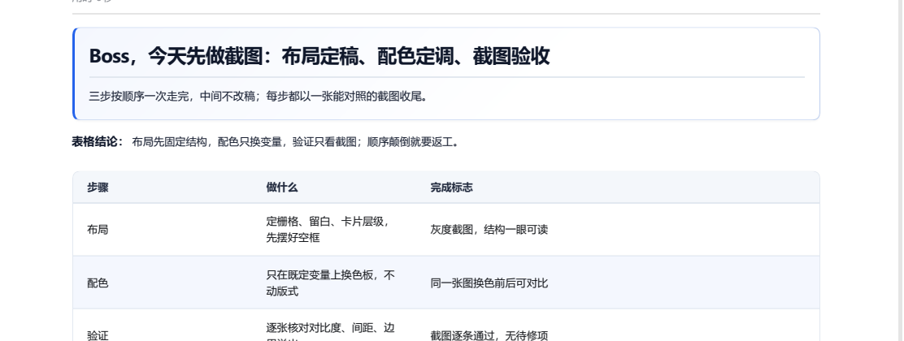
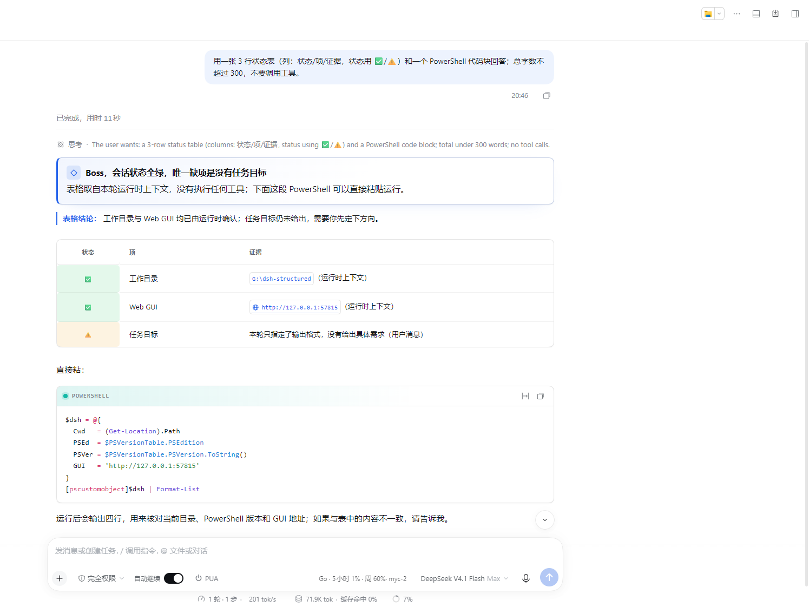
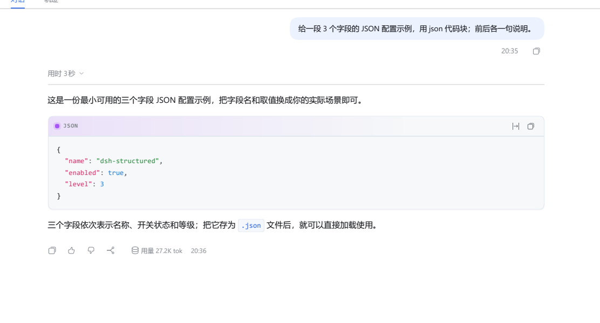
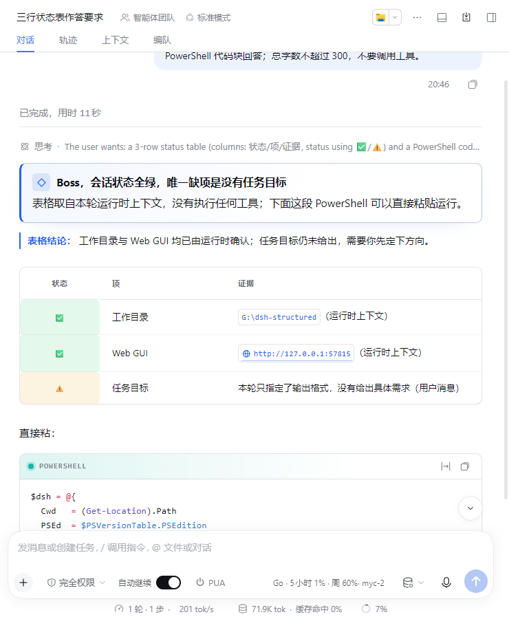
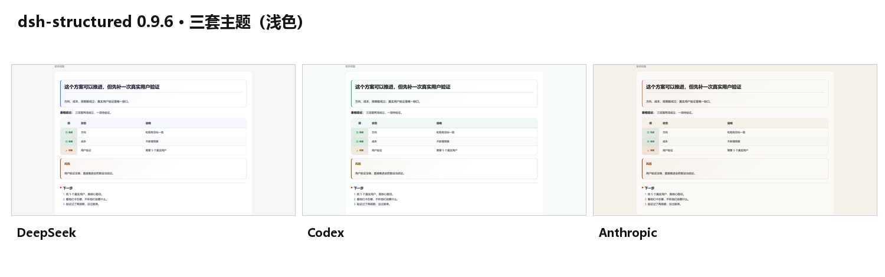
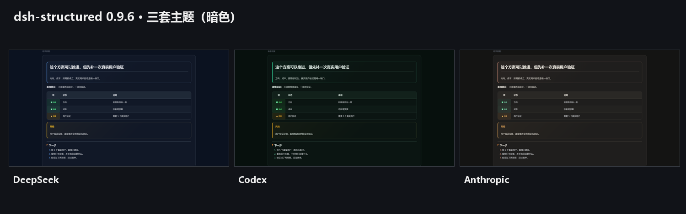
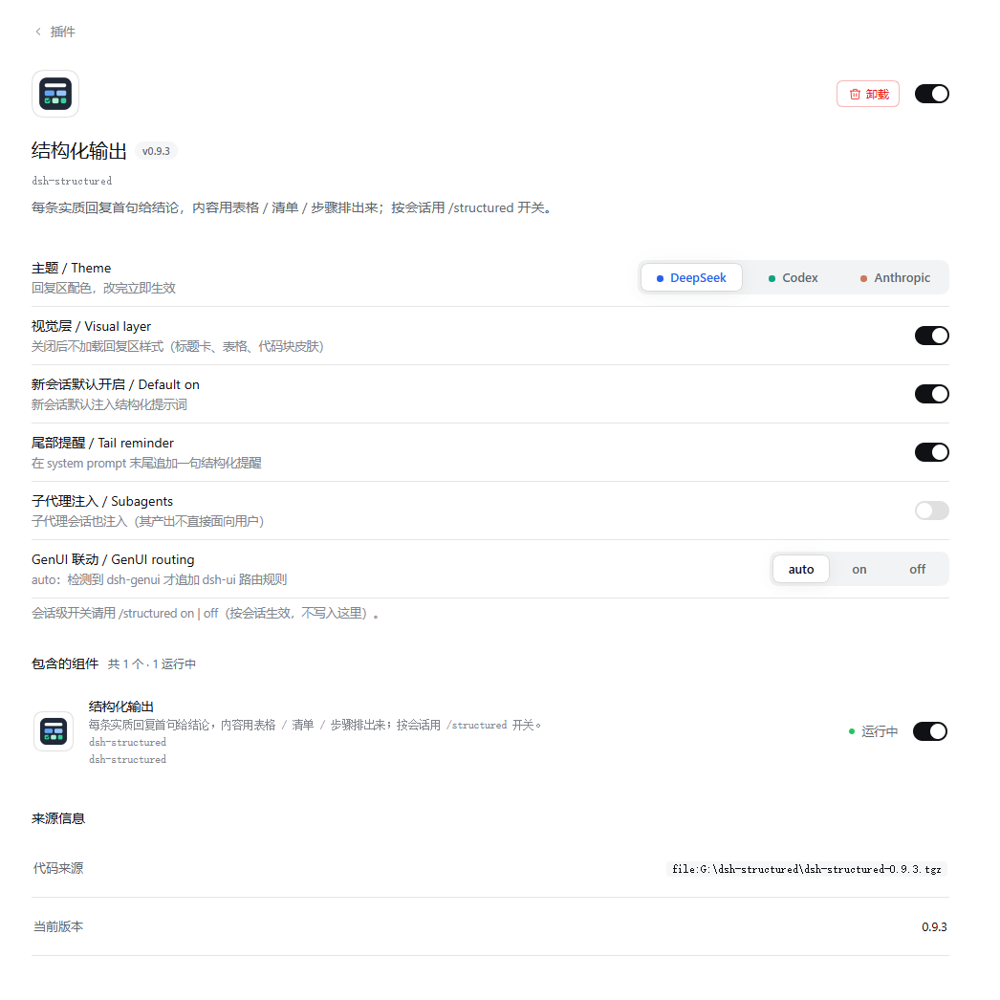

# dsh-structured

让 DSH 的每条实质回复默认结构化：**首句给结论，内容用表格 / 清单 / 步骤排出来**。按会话开关，默认开启；规则可用 `style.md` 整份覆盖。

它解决的是一个实测问题：只靠 `~/.dsh/AGENTS.md` 第 7 节的提示词规则，56 条符合触发条件的回复里只有 21 条真的结构化（37.5%），长上下文下继续衰减。本插件把同一条规则放进**每次请求都会重新求值的 system prompt section**，并在末尾追加一句轻量提醒，不依赖模型记住历史。

路线图：Phase 1 结构化已完成；Phase 2 做视觉热点规范引导与卡片系统，见 [`docs/ROADMAP.md`](docs/ROADMAP.md)。

## 判定优先级

1. 老板读得快不快
2. 会不会打断会话（稳定性）
3. token 成本
4. 实现优雅

对应到实现：注入只有一条规则段（约 400 字）+ 一句尾部提醒（约 50 字）；任何异常都放行原请求；不接管 GenUI，不改 agent 循环。

## 安装

要求：DSH 0.2.x – 0.3.x（`@deepseek-ai/cordis` 4.x），Node ≥ 22。

**默认目标就是 desktop profile。** 插件只硬依赖 `systemPrompt`（desktop 由 `@deepseek-ai/dsh-base` 提供），`commands` 是可选服务；不依赖 Electron/headless 专有 API，也没有 profile 分支。安装前先跑一次预检：

```powershell
node scripts/desktop-check.mjs
```

`desktop` 由 Electron 独占只影响 **CLI 的 `--profile desktop` 子命令**，不影响插件本身；推荐走插件管理入口，或退出 Desktop 后手工 pnpm（方式二）。

### 方式一：插件市场

在 DSH 插件管理里搜索 `dsh-structured` 安装；市场收录后可用。桌面端由应用侧加载 client，不需要浏览器刷新。

### 方式二：npm

```powershell
dsh plugin --profile <profile> add dsh-structured
```

desktop profile 由 Electron 独占，使用插件管理搜索/安装，不要跑 `--profile desktop`。

### 方式三：GitHub Release

从 GitHub Releases 下载最新版的 `dsh-structured-<version>.tgz`（当前 0.9.1），在插件管理里选择本地包；不使用 npm 时，市场 YAML 的 `tarball` 指向该 release。

### 开发方式：本地 tgz / 手工 pnpm（desktop profile）

本地包只用于开发验证：在 DSH 插件管理里选择仓库根的 `dsh-structured-<version>.tgz`，或 `plugin_manager.install_bundle` 指向该文件。手工 pnpm 方式如下。

`desktop` profile 由 Electron 独占：**全局 `dsh plugin --profile desktop ...` 会被 CLI 直接拒绝**（`profile "desktop" is managed exclusively by the Electron application`）。不要用那条命令。要先**完全退出 Desktop**，再在 profile 目录里手工 pnpm：

```powershell
$dir = Join-Path $env:DSH_HOME 'profiles\desktop'
Copy-Item "$dir\package.json" "$dir\package.json.bak-before-dsh-structured"
Copy-Item "$dir\pnpm-lock.yaml" "$dir\pnpm-lock.yaml.bak-before-dsh-structured"
Copy-Item "$dir\cordis.patch.yml" "$dir\cordis.patch.yml.bak-before-dsh-structured"

Set-Location $dir
$tgz = "dsh-structured-0.9.1.tgz"   # 把 tgz 放到当前目录，或写成实际路径
pnpm add $tgz
```

手工 pnpm **不会**自动改 bundle 列表，需要把 `dsh-structured` 加进 `$dir\package.json` 的 `dsh.profile.bundles`（只加一次，不要重复）：

```json
{
  "dsh": { "profile": { "bundles": ["...", "dsh-structured"] } }
}
```

启动 Desktop。

开发期用独立测试 profile 时，`dsh plugin --profile <测试 profile> add <tgz>` 可以正常使用，并且会自动追加 bundle 行；新 profile 可用 `dsh <name> --from-default-profile headless "..."` 创建。

### Desktop 兼容性依据

- 预检：`node scripts/desktop-check.mjs` 全部 PASS —— desktop profile 已初始化、bundle 栈含 `dsh-base`/`dsh-web-app`、`files` 含 `cordis.patch.yml`、`main`/`exports` 指向存在文件、`dsh.client.platform: web` 与 `exports["./client"]` 就位、`engines.dsh`/`dsh.compatibility.dshReleases` 已声明、运行时只 import `node:`、无 Electron 专有 API、无 profile 分支、状态走 `DSH_HOME`。
- **desktop 是主目标，Web 只做兼容。** 本会话本身运行在 desktop profile，`systemPrompt` 与 `commands` 由 live host 的 Service 查询确认；`dsh.client.platform: web` 是 DSH 客户端模块的格式（desktop 的 Web UI 也加载它），不代表 Web 优先。
- desktop 实装实测：desktop profile 已装 0.9.1（`dependencies`/`bundles` 各一处，见 `docs/MAINTENANCE-LOG.md` 2026-10-23 条目）；desktop 会话最新 `system/message` 命中注入（可用 `scripts/session-inspect.mjs` 复跑）。
- 视觉层由 desktop 应用侧加载，验收以应用内实际渲染为准；不要求用户手动刷新。

### 兼容性门禁

本包声明 `@deepseek-ai/schemastery` peer：`Config`（theme/visual/defaultEnabled/tailReminder/includeSubagents/genui）用它生成设置表单；这是 host 提供的服务，不是门禁。真正门禁是 `engines.dsh`（`>=0.1.7-rc.2 <0.4.0-0`，0.9.4 起覆盖 0.3.x），`dsh-app-boot` 在有 `engines.dsh` 时读取它；`dsh.compatibility.dshReleases` 是 advisory。实测 DSH CLI `0.1.7-rc.2` 与 desktop `0.2.1-rc.2`；`0.2.1-rc.3` / `0.3.0-rc.1` 为声明性兼容（插件依赖的 systemPrompt / commands / configForms / plugins.bundle.config 均为宿主稳定服务面，未见破坏性变更公告；未逐项实测，实测后将更新标注）。

## 使用

```text
/structured            # 查看本会话状态
/structured off        # 关闭本会话（下一轮生效）
/structured on         # 重新开启
/structured status     # 同 /structured
```

- 开关按会话独立，状态落在 `$DSH_HOME/dsh-structured/state.json`（tmp + rename 原子写）。
- 新会话默认开启；`defaultEnabled: false` 可改默认值（见配置）。
- 视觉层由插件设置 `visual` 控制（默认开启），不写 `state.json`；`/structured on|off` 只控制提示词注入，不影响视觉层。
- 自定义规则：写 `$DSH_HOME/dsh-structured/style.md`，**非空即整份覆盖**内置文本，保存后下一轮生效；文件为空或删除时回落内置。
- **用 `style.md` 承载人格 / 长期设定（可选）**：`style.md` 的内容会被原样放进每次请求的 section，所以也可以写人格、收尾格式或长期设定；代价是**整份覆盖**——内置结构化规则会消失。想同时保留两者，把 `src/index.js` 的 `BUILTIN_STYLE_TEXT` 全文抄进去，再在后面追加人格段。只当人格用、不需要结构化时，建议把 `tailReminder` 设为 `false`，否则尾部提醒仍会要求「首段 markdown 标题卡」。`style.md` 位于 `$DSH_HOME`，所有 profile 共用同一份。
- 内置文本与 `~/.dsh/AGENTS.md` 第 7 节同源：首句结论、组件化正文、一段一主题、禁过程叙事与复述、证据优先、短答不套卡；清晰优先，不设硬性篇幅上限。

### 代码 / diff 例外

- ` ```diff ` / ` ```patch ` 代码块、`[data-diff]`、`.md-diff`、`[class*="_diff_"]` 与 GenUI diff 区域**不套**插件的代码块/表格 chrome；diff 行色与宿主渲染保持原样。`data-diff`/类名守卫是防御性选择器，当前 host 是否真实可达未单独 live 验证。
- 当回复主要是代码、代码 diff、文件修改或补丁时，代码块或 diff 卡可以直接作为第一块，不强制标题卡；仍不写过程叙事。
- `/structured off` 仍只控制提示词；视觉层由插件设置 `visual` 控制。

### 视觉层（desktop 主目标；web 兼容）

客户端半区会给对话 markdown 加一层排版：标题层级与图标方块、表头/细横线/状态列、代码块语言色与贴合 banner、风险/验收/结论三色卡片、结论/下一步卡、列表/链接/分隔线。`theme` 提供 `deepseek`（默认）/`codex`/`anthropic` 三套 token；`--ds-accent` 负责任 fill/border/icon，`--ds-accent-text` 负责文字/链接/标签/行内 code/表格结论（保证小字 AA）；暗色走宿主 `body[data-ds-dark-theme]`。Codex 为绿 `#10A37F`/文字 `#0B6B4F`，Anthropic 为陶土 `#CC785C`/文字 `#A14A2E`，DeepSeek 默认蓝 `#2563EB` 不变；只给宿主节点加 class/attribute，不改消息内容，headless / CLI 不加载 client 半区。

视觉方向只做一套：**Linear 的秩序 + Notion 的卡片 + Stripe 的信息密度 + Vercel AI Elements 的回复结构**，见 [`docs/DESIGN-REFERENCES.md`](docs/DESIGN-REFERENCES.md)。卡片用图标方块 + 13px 标签 + 淡色表面；状态只在 68px 状态列着色，不再整行 pastel；表格结论用强调左规线。`theme` 只切换 token，不做主题市场/自定义 CSS/按消息主题。

设计与分阶段计划见 [`docs/VISUAL-PLAN.md`](docs/VISUAL-PLAN.md)，视觉热点/层级诊断见 [`docs/VISUAL-CRITIQUE.md`](docs/VISUAL-CRITIQUE.md)，卡片类型与热点预算见 [`docs/CARD-SYSTEM.md`](docs/CARD-SYSTEM.md)。视觉层由插件设置 `visual` 控制（默认开启），`theme` 控制三套 token；`/structured on|off` 只控制提示词注入。

Phase 2 已落地 2.1–2.4：卡片类型（结论/判断/指标/风险/下一步/验收/重点）、`data-dsh-structured-card-type` 归属标记、GenUI 软联动（检测到才追加 `dsh-ui` 路由，未检测走纯 markdown fallback，不硬依赖）。

## Screenshots















`screenshots.json` 列出全部 7 张：前 4 张是 0.9.6 的真实界面裁图（web profile 渲染，覆盖标题卡、表格 + 表格结论、状态列、代码块与 800px 窄窗）；09/10 两张是按 0.9.6 实际 token 渲染的主题对照图（不是桌面实机截图）；第 7 张是 0.9.2 起插件板块 → dsh-structured 详情页的配置区截图（六字段 + 主题分段按钮带各主题强调色，0.9.6 未改配置页）。GenUI 截图因避免暴露工作区未收录。

### 配置

**首选：插件板块 → dsh-structured → 详情页的配置区**（0.9.2 起）。插件自己的浏览器半侧把六个字段注册进宿主 `plugins.bundle.config` slot，改完立即写入 active profile 的 Cordis patch：

```text
主题 / Theme           deepseek | codex | anthropic
视觉层 / Visual layer   开关
新会话默认开启           开关
尾部提醒 / Tail reminder 开关
子代理注入 / Subagents   开关
GenUI 联动              auto | on | off
```

宿主 describe 未服务本插件、或部署缺少前端 primitives 时，配置区自动隐藏（此时用下面的 patch 方式）。会话级开关不在这里：用 `/structured on | off`。主题分段的三个选项各带所代表主题的强调色圆点，选中态文字同色（0.9.3 起）。

底层方式：在 profile 的 `cordis.patch.yml` 里覆盖同一行（注意：config 是整份替换，不是深合并）：

```yaml
- id: dsh-structured
  config:
    theme: deepseek        # deepseek | codex | anthropic；三套主题 token
    visual: true           # 客户端视觉层；由插件设置页切换，不写 state.json
    defaultEnabled: true   # 新会话默认开启
    tailReminder: true     # system prompt 末尾追加一句提醒
    includeSubagents: false # 子代理会话不注入（它的产出不直接面向用户）
    genui: auto            # auto | on | off；auto 检测到 GenUI 才追加 dsh-ui 路由
```

`theme`、`visual`、`defaultEnabled`、`tailReminder`、`includeSubagents`、`genui` 都是 `.volatile()` 配置：插件板块详情页的配置区（0.9.2 起，见上）与标准 bundle 表单都可编辑，写入走 active profile 的 Cordis patch，home patch / CLI overlay 优先。若快照的 `writable` 为 false，说明当前配置被上层覆盖，配置区控件只读并提示，不会静默写入成功；请改上层配置或接受只读。`/structured on|off` 只影响 `state.json` 里的按会话提示词开关，不影响 `theme`/`visual`。

## 验证注入生效

会话日志是 `$DSH_HOME/sessions/<cwd-group>/<session-id>/session.v4.jsonl.zstd`（独立 zstd 帧拼接，普通 grep 读不了）。仓库自带读取脚本：

```powershell
# 最近一个会话里搜注入文本（开启状态应命中 1 条）
node scripts/session-inspect.mjs --grep "结构化输出（本会话已启用"

# 指定会话
node scripts/session-inspect.mjs --session session-xxxx --grep "结构化输出（本会话已启用"

# 只看最新一条 system/message（验证「关掉后下一轮 0 命中」）
node scripts/session-inspect.mjs --session session-xxxx --last-system --grep "结构化输出（本会话已启用"
```

开启时应看到：

```text
搜索："结构化输出（本会话已启用" → 命中 1 条 system/message
```

关闭后（`/structured off` 或把该会话在 `state.json` 里置为 `false`），同一个会话下一轮应看到 `命中 0 条`。视觉层由插件设置 `visual` 控制，`/structured` 只控制提示词注入，不关闭 client 视觉层。

> 以上命令在仓库根执行。已装到 profile 时，脚本路径是 `<profile>\node_modules\dsh-structured\scripts\`；把命令里的 `scripts/` 换成 `node_modules/dsh-structured/scripts/` 即可。

## 卸载 / 回滚

一条命令（仓库根执行；已装到 profile 时用 `<profile>\\node_modules\\dsh-structured\\scripts\\uninstall.mjs`）：

```powershell
node scripts/uninstall.mjs --profile <profile> --dry-run
node scripts/uninstall.mjs --profile <profile>
```

它会先执行 `dsh plugin --profile <profile> remove dsh-structured`（移除依赖、bundle 行和 `node_modules`），再删除 `$DSH_HOME/dsh-structured`（state.json / style.md）。只删这两个目标，不碰其他插件。

手工 pnpm 回滚：退出 Desktop，按 `package.json` / `pnpm-lock.yaml` 备份恢复，或 `pnpm remove dsh-structured`；如果 `dsh.profile.bundles` 里还有这一行，手工删掉。重新打开 Desktop（应用重新加载，不是浏览器刷新）。

卸载后检查：`node_modules` 下没有 `dsh-structured`，`package.json` 里没有依赖与 bundle 行，`$DSH_HOME/dsh-structured` 不存在。

## 效果指标

口径固定、可复跑：`scripts/measure-prose.mjs`。

- **实质回复**：去掉代码块后可见字符 ≥ 120，且句子数 ≥ 2。
- **结构化**：≥2 行表格 / ≥2 个清单项 / ≥2 个标题 / ≥1 个 `dsh-ui` 组件块。
- **散文违规**：实质回复但没有结构化，且句子数 ≥ 3。
- **散文率**：散文违规数 ÷ 实质回复数。

```powershell
# 最近 14 天的会话
node scripts/measure-prose.mjs --since-days 14 --verbose

# 指定会话（A/B 对照时最常用）
node scripts/measure-prose.mjs --sessions session-a,session-b --json
```

同一测试 profile、同一模型、同一组 12 条 prompts 的配对采样结果见 [`docs/METRICS.md`](docs/METRICS.md)。核心数字：

| 样本 | 口径 | 散文率 |
| --- | --- | ---: |
| 改前历史（737 会话 / 5727 条实质回复） | 首屏 300 字符 | **38.7%** |
| 改前历史（同一批） | 整篇 | 16.8% |
| 改后（12 个新会话） | 首屏 / 整篇 | **0.0%**（0/12） |

任务书给定的人工基线是 37.5%（21/56），与首屏口径的 38.7% 基本一致。同 prompt 配对对照里 baseline 也是 0%，说明这批短问题本身就能被 AGENTS.md 覆盖；插件可证明的作用是 12/12 请求都带规则段与尾部提醒。完整的样本、命令、长上下文试点和局限都在 `docs/METRICS.md`。

## 设计边界（这些是刻意不做）

- **不用 `agent/pre-step` 往请求里 append 消息**。DSH v4 要求 `source.kind` 属于宿主注册的 producer，自造 kind 会让整回合失败：`format v4 message requires a producer-owned source kind`。
- **不 append 消息、不改 agent 循环、不改工具权限、不接管 GenUI**。GenUI 负责组件渲染，本插件只负责「强制形状 + 注入规则」。
- **fail-open 是红线**：section 求值、`style.md` 读取、状态读写、`/structured` 处理全程 try/catch；section 求值失败返回空串，本轮不结构化但请求照常放行。
- `interpolate: false`：`style.md` 里出现 `{{...}}` 也不会触发严格变量插值而打断组装。
- 子代理默认不注入：子代理产出由父代理消费，不是用户可见回复，注入只会浪费上下文。

## 目录

```text
src/index.js                 host 入口（systemPrompt section + 会话开关 + 命令）
src/client.js                client 模块（视觉层 + 结论卡 + 语义装饰）
lib/index.js                 host 构建产物
lib/client.js                client 构建产物
cordis.patch.yml             bundle 装配清单
scripts/build.mjs            构建
scripts/uninstall.mjs        卸载后清理状态目录
scripts/session-inspect.mjs  验证 system prompt 注入
scripts/desktop-check.mjs    desktop 兼容性预检
scripts/measure-prose.mjs    散文率统计（可复跑）
scripts/lib/session-log.mjs  v4 会话日志 zstd 帧读取
test/structured.test.mjs     单元测试 + 边界测试
test/client-visual.test.mjs  client visual 配置开关测试
test/client-cards.test.mjs   严格卡片识别 DOM 测试
docs/METRICS.md              A/B 指标与原始明细
docs/ROADMAP.md              Phase 1/2 路线图与 Phase 2 任务
docs/CARD-SYSTEM.md          卡片类型、anatomy 与热点预算
docs/DESIGN-REFERENCES.md    视觉引导参考与反例
docs/VISUAL-PLAN.md          视觉排版方案与阶段计划
docs/VISUAL-CRITIQUE.md      视觉诊断与热点预算
ACCEPTANCE.md                3 行验收记录
```

## 已知限制

- 注入是概率性约束，不是格式校验：模型仍可能忽略；指标文档记录了实测比例。
- 状态目录按 `DSH_HOME` 共享，不区分 profile；测试 profile 的开关会落到同一个 `state.json`。
- 视觉层是渐进增强，只在 desktop 客户端生效（Web 客户端作为同源兼容面，不单独验收）；headless / CLI 不加载 client 半区，host 注入不受影响。
- 视觉层依赖宿主内部 class 名（`[class*="_markdown_"]`、`.md-code-block`）；宿主升级后若改名，会自动退化为原生 markdown，需要按 `docs/VISUAL-PLAN.md` 跑一次视觉回归。
- `style.md` 是整份覆盖，不做片段合并。
- 裸 `$...$` 由宿主按 `singleDollarTextMath` 解析成行内公式；需要显示美元符号时用 `\$` 转义或放进反引号；插件不改写消息内容，也不替宿主决定公式语义。
